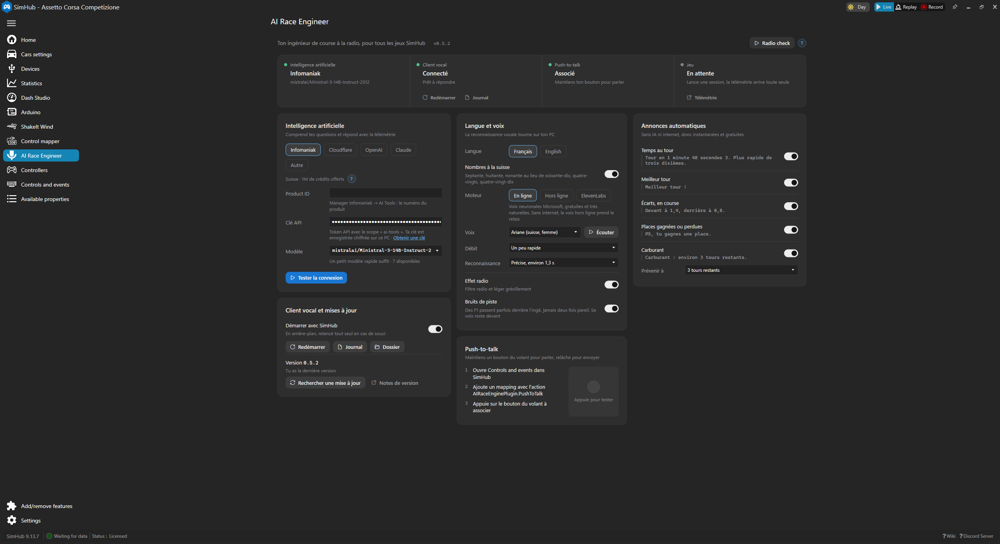

# AI Race Engineer pour SimHub

[English](README.md) · **Français**



Un ingénieur de course vocal pour **tous les jeux supportés par SimHub** (ACC, iRacing, LMU, rFactor 2, AC, F1...).
Tu maintiens un bouton du volant, tu poses ta question comme tu veux (« il est à combien le mec devant ? »,
« mes pneus ça va ? », « j'ai assez d'essence ? »), et l'ingé te répond à la radio. Il t'annonce aussi tout seul
ton temps au tour, tes écarts, tes changements de place et quand le carburant devient juste.

```
Jeu ──► SimHub ──► plugin AI Race Engineer (réglages, annonces, push-to-talk, télémétrie JSON)
                                │
             client vocal (lancé tout seul) : micro ─► Whisper local ─► IA ─► voix neuronale / Kokoro / ElevenLabs
```

## Ce que ça coûte

| Brique | Par défaut | Coût |
|---|---|---|
| Reconnaissance vocale | Whisper local (faster-whisper) | gratuit |
| Voix | voix neuronales Microsoft (en ligne), Kokoro en secours hors ligne | gratuit |
| Annonces automatiques | générées par le plugin, sans IA | gratuit |
| Questions (IA) | Infomaniak (1M de crédits offerts), Cloudflare (quota gratuit quotidien), OpenAI ou Claude | quelques centimes par course |
| Option voix premium | ElevenLabs Flash | payant |
| Option IA 100 % locale | Ollama (fournisseur « Autre ») | gratuit, mais partage la carte graphique avec le jeu |

## Installation

Deux façons, au choix. Les deux s'occupent de tout (Python, dépendances, modèles de voix) : rien à installer à la main.

### Installateur Windows

Télécharge **`AIRaceEngineer-Setup.exe`** depuis la [dernière release](https://github.com/IIPoliII/simhub-ai-race-engineer/releases/latest)
et double-clique dessus. Il demande la langue de l'installation, français ou anglais (celle de ton installation
actuelle est présélectionnée, sinon celle de ton Windows). Pour une nouvelle installation, c'est aussi la langue
du plugin.

- Si SimHub est ouvert, l'installateur te demande de le fermer. À la fin, laisse « Lancer SimHub » coché.
- Au premier démarrage, le plugin installe la voix tout seul : [uv](https://docs.astral.sh/uv/), Python,
  la reconnaissance vocale et la voix hors ligne (~1 Go, quelques minutes). La page du plugin montre l'avancement.
- Désinstallation : Paramètres Windows → Applications. Le plugin, le client vocal et sa voix hors ligne sont
  retirés, tes réglages sont gardés. Des dossiers partagés restent, supprime-les à la main si rien d'autre ne s'en
  sert : les modèles de reconnaissance vocale (~600 Mo, `%USERPROFILE%\.cache\huggingface`) et uv
  (`%USERPROFILE%\.local\bin\uv.exe`, avec son Python et son cache dans `%APPDATA%\uv` et `%LOCALAPPDATA%\uv`).
  Avec des accents dans ton nom d'utilisateur Windows, la voix hors ligne garde aussi une copie de ses données de
  phonétique, lisible par ton compte seul, dans `C:\ProgramData\AIRaceEngineer-S-1-5-…` (~20 Mo).
- Réparation : relance `AIRaceEngineer-Setup.exe` et choisis « Réparer ».
- L'installateur n'est pas signé : Windows SmartScreen peut afficher « Windows a protégé votre ordinateur ».
  Clique « Informations complémentaires », puis « Exécuter quand même ».
- Pour un déploiement silencieux, la release contient aussi **`AIRaceEngineer-Setup.msi`**, qui contient les deux langues
  et prend celle de Windows : `msiexec /i AIRaceEngineer-Setup.msi /passive` (ajoute `ProductLanguage=1036` pour le
  français ou `ProductLanguage=1033` pour l'anglais).

### En une ligne

Colle cette commande dans PowerShell (ou télécharge **`Installer-AIRaceEngineer.cmd`** depuis la release et
double-clique dessus) :

```powershell
irm https://raw.githubusercontent.com/IIPoliII/simhub-ai-race-engineer/main/install.ps1 | iex
```

Elle trouve SimHub, installe le client vocal dans `%LOCALAPPDATA%\AIRaceEngineer` avec uv et Python, télécharge
la voix et la reconnaissance vocale, attend que SimHub soit fermé et copie le plugin.

### Droits administrateur

Pas besoin : l'installateur de SimHub laisse les utilisateurs écrire dans son dossier. Si ce dossier est protégé
sur ta machine, l'installateur ne pourra pas y copier le plugin : utilise la commande en une ligne, qui demande alors
l'autorisation Windows (les droits du dossier ne sont jamais modifiés).

## Réglages

Relance SimHub et accepte d'activer **AI Race Engineer** : il apparaît dans le menu de gauche (sinon : Settings → Plugins).
Tout se règle dans sa page, rangée en colonnes pour tenir sur un écran, en français ou en anglais : la page,
la fenêtre de bienvenue et les guides suivent le réglage Langue, et l'ingé parle cette langue aussi. En haut, une
bande d'état montre l'IA, le client vocal, le push-to-talk et le jeu, avec ce qu'il reste à faire. Une fenêtre de
bienvenue résume les choix au premier démarrage (le ? en haut de la page la rouvre), et le ? à côté de chaque IA et
d'ElevenLabs ouvre un guide pas à pas : où créer le compte, quoi copier, combien ça coûte.

- **Langue et voix** : français ou anglais (par défaut, la langue choisie dans l'installateur, sinon celle de ton
  Windows), puis le moteur de voix :
  - **En ligne** (par défaut) : voix neuronales Microsoft, gratuites et très naturelles (Henri, Denise, Rémy, Fabrice et
    Ariane en suisse, Antoine en québécois ; Ryan, Thomas, Sonia, Andrew, William en anglais). Sans internet, la voix hors ligne prend le relais ;
  - **Hors ligne** : Kokoro, sur ton PC (en anglais, `George` sonne très « ingé britannique ») ;
  - **ElevenLabs** : la plus réaliste, payante au-delà de l'offre gratuite.

  Le bouton **Écouter** à côté de la voix la fait entendre ; **Radio check** en haut de la page marche avec tous
  les moteurs, ElevenLabs compris. Effet radio et reconnaissance rapide ou précise en option. **Nombres à la
  suisse** fait dire septante, huitante, nonante (coché d'office si Windows est réglé sur la Suisse,
  où Ariane est aussi la voix française par défaut).
- **Bruits de piste** : avec l'effet radio, des F1 passent parfois derrière l'ingé, comme au muret des stands.
  Rien n'est enregistré : chaque voiture est synthétisée à chaque message (régime, passages de rapport, distance,
  effet Doppler), donc jamais deux fois le même son, et parfois aucun. Le fond baisse quand l'ingé parle pour que
  sa voix reste parfaitement lisible.
- **Volumes** : deux curseurs, un pour la voix de l'ingé (50 à 200 %, les crêtes sont arrondies au-delà de 100 %
  pour ne pas saturer) et un pour les bruits de piste (0 à 200 %). Double-clic : retour à 100 %.
- **Intelligence artificielle** : Infomaniak, Cloudflare, OpenAI, Claude, ou n'importe quelle API compatible
  OpenAI (Ollama...). Une fois la clé collée, la liste « Modèle » se remplit avec les modèles disponibles chez
  le fournisseur, les conseillés en tête. Le bouton **Tester la connexion** vérifie la clé et le modèle. Si l'API
  refuse le modèle, la page propose ceux qu'elle accepte en un clic.
  - Autre (Ollama, LM Studio) : l'URL du serveur, `/v1` est ajouté s'il manque. Les modèles qui réfléchissent
    (Qwen3...) sont mis en réponse directe (`reasoning_effort: none`) ; un serveur qui ne connaît pas ce réglage
    est réinterrogé sans.
  - Infomaniak : un token avec le scope `ai-tools` et le Product ID (Manager → AI Tools). Modèle par défaut : `mistralai/Ministral-3-14B-Instruct-2512`.
    Le plugin utilise l'API v2 d'Infomaniak, qui donne accès à tout leur catalogue (Mistral Small 4, Gemma 4...).
  - Cloudflare : un token API Workers AI et ton Account ID.
- **Annonces automatiques** : temps au tour comparé au précédent, meilleur tour, tour invalidé (dès que le jeu
  l'invalide, puis rappelé avec le temps), écart au meilleur tour à chaque secteur (hors course), écarts
  devant/derrière (en course), places gagnées ou perdues, alerte carburant (à 2, 3, 4 ou 5 tours). Chaque annonce
  montre un exemple de phrase.
- **Push-to-talk** : dans **Controls and events**, ajoute un mapping avec l'action
  `AIRaceEnginePlugin.PushToTalk` et appuie sur le bouton de ton volant. La page du plugin montre en direct
  si le bouton est détecté.

Les clés API sont enregistrées chiffrées (DPAPI Windows) dans `%LOCALAPPDATA%\AIRaceEngineer\settings.json`.

Le client vocal démarre et s'arrête avec SimHub, et redémarre tout seul s'il s'arrête. En cas de souci, la case
« Client vocal » affiche la cause, et le bouton « Journal » ouvre son journal.

**Mises à jour** : au démarrage, le plugin vérifie s'il existe une nouvelle version. Si oui, un bandeau apparaît en haut
de sa page et la section « Client vocal et mises à jour » affiche « Installer la X.Y.Z » : clique sur l'un ou l'autre. La nouvelle version est préparée dans ton profil, et elle remplace l'ancienne
quand SimHub se ferme (le plugin propose de le redémarrer tout de suite), après vérification de son empreinte.
Pas de demande d'autorisation Windows, sauf si le dossier de SimHub est protégé : elle est alors demandée à chaque
mise à jour. Le client vocal est mis à jour en même temps. Paramètres Windows → Applications garde la version installée
par le Setup ; c'est normal. Ce qui change à chaque version : [CHANGELOG.fr.md](CHANGELOG.fr.md). Le bouton
« Notes de version » de la page du plugin l'affiche dans SimHub, et après une mise à jour une fenêtre « Nouveautés »
montre ce qui a changé.

**Performances** : le plugin est fait pour laisser la machine au jeu.
- Le client vocal tourne en priorité « inférieure à la normale », et la reconnaissance vocale et la voix hors ligne
  utilisent au plus la moitié des cœurs (4 maximum).
- Le client et SimHub ne s'échangent presque rien au repos : une requête qui attend qu'il se passe quelque chose
  (bouton, annonce), au lieu d'interroger en boucle.
- La télémétrie n'est mise en forme que quand l'ingé en a besoin, et les bruits de piste coûtent quelques
  dizaines de millisecondes par message.

## Latence

Mesurée sur CPU, sans GPU :

| Étape | Temps |
|---|---|
| Reconnaissance précise (Whisper `small`, question de 3-4 s) | ~1,3 s |
| Reconnaissance rapide (Whisper `base`) | ~0,4 s |
| IA cloud (petit modèle) | ~0,5-1 s |
| Voix en ligne (une phrase) | ~1-2 s |
| Voix Kokoro (une phrase) | ~0,8 s |

Les annonces automatiques n'ont pas besoin de reconnaissance vocale ni d'IA : elles partent directement.

## Ce que l'ingé sait

Session (type, piste, temps et tours restants, météo, drapeau), position, temps au tour (dernier, meilleur, delta),
écart au leader, carburant et tours restants estimés, consommation des derniers tours (hors tours aux stands), pneus
(pressions, températures, usure), températures des freins, dégâts, TC/ABS/répartition de freinage,
et la voiture devant et derrière (nom, écart, derniers tours, passages aux stands).

Les données dépendent du jeu. Si un jeu ne fournit pas une valeur (par exemple l'usure des pneus dans ACC),
elle vaut `null` quand le plugin peut le savoir, et l'ingé te le dit au lieu d'inventer.
TC ou ABS à 0 peut vouloir dire désactivé ou non fourni par le jeu : l'ingé te le dit quand il ne peut pas savoir.
En multiclasse, ta position, l'écart au leader et les voitures devant et derrière sont ceux de ta classe
(l'ingé connaît aussi ta place au général).

## Arrêt au stand : « box box »

Dis « box box » ou « pit pit » (ou « box ce tour », « je rentre au stand ») : l'ingé confirme, donne l'essence à remettre pour finir
la course avec un tour de marge (d'après ta consommation moyenne et le temps ou les tours restants) et te demande quels
pneus tu veux. Réponds comme tu veux (« des mediums neufs, le plein, on répare ») : il récapitule le programme.
À l'entrée des stands, il te le rappelle (« Box, box. Pneus : mediums. Essence : 32 litres. Limiteur ! »).
« Annule le box » ou « on reste dehors » l'annule ; sans arrêt deux tours plus tard, il tombe.

Ça marche avec tous les jeux, mais l'ingé ne règle rien dans le jeu : c'est toi qui fais les réglages du menu des stands.

## Structure

```
plugin/                 Plugin SimHub (C#, .NET Framework 4.8)
  AIRaceEnginePlugin.cs   télémétrie JSON, file d'annonces, push-to-talk
  Callouts.cs             annonces automatiques (tour, secteurs, écarts, positions, carburant)
  Settings.cs             réglages, fournisseurs d'IA, voix, config envoyée au client
  SettingsControl.cs      page du plugin dans SimHub
  Theme.cs                thème de la page (couleurs, boutons, interrupteurs, segments)
  ClientRunner.cs         lance le client vocal en arrière-plan (et le met en route au premier démarrage)
  Guides.cs               fenêtre de bienvenue et guides ? de chaque IA
  L10n.cs                 langue de la page : T(fr, en) et Msg (textes dans les deux langues)
  SnapshotServer.cs       mini serveur HTTP sur 127.0.0.1:8889
  Updater.cs              mises à jour depuis les releases GitHub
  LlmTester.cs            bouton « Tester la connexion »
  ModelCatalog.cs         liste des modèles disponibles chez le fournisseur
client/                 Client vocal (Python)
  engineer.py             boucle principale (dialogue avec le plugin)
  stt.py / llm.py / tts.py / audio.py / ambience.py
  sample_snapshot.json    télémétrie d'exemple pour tester sans jeu
installer/              Installateur Windows
  AIRaceEngineer.wxs      MSI (WiX 5), textes en-US.wxl / fr-FR.wxl (les deux dans un seul MSI)
  Setup/                  AIRaceEngineer-Setup.exe : choix de la langue, puis le MSI
tools/CompatCheck/      vérifie qu'un plugin compilé se charge encore dans une version de SimHub
.github/                GitHub Actions : compilation, releases, vérification quotidienne avec SimHub
install.ps1             installateur en une ligne (dernière release)
Installer-AIRaceEngineer.cmd   la même chose en double-clic
dev-install.ps1         [dev] compile le plugin depuis les sources et l'installe
release.ps1             [mainteneur] construit tout et publie une release (lancé par GitHub Actions)
```

## Développement

Plugin : [.NET SDK](https://dotnet.microsoft.com/download) 8 ou plus récent (Visual Studio n'est pas nécessaire) et
SimHub dans son dossier par défaut (sinon `-SimHubDir <dossier>`). SimHub fermé, puis `.\dev-install.ps1`. Il
n'installe que la DLL du plugin : le plugin lance toujours le client vocal installé dans
`%LOCALAPPDATA%\AIRaceEngineer\client` (par le Setup ou la commande en une ligne), jamais celui de `client/`.

Client : `cd client`, puis `uv run engineer.py` (SimHub doit tourner avec le plugin). Si le client installé tourne
aussi, désactive « Démarrer avec SimHub » et redémarre SimHub avant, sinon chaque annonce passe deux fois.
Pour tester sans jeu :

```powershell
uv run engineer.py --say "Box box, box box."
uv run engineer.py --ask "il est à combien le mec devant ?" --snapshot sample_snapshot.json
```

`--say` marche aussi sans SimHub. `--ask` demande SimHub lancé avec le plugin et une IA réglée, mais pas de jeu :
`--snapshot` remplace seulement la télémétrie du jeu.

Publier : monte `<Version>` dans `plugin/AIRaceEngineer.csproj` et `version` dans `client/pyproject.toml` (le même
numéro), lance `uv lock` dans `client`, et écris les notes dans `CHANGELOG.md` et `CHANGELOG.fr.md`. Commite, fusionne
dans `main` et pousse `main`, puis tague ce commit `vX.Y.Z` et pousse le tag. Les releases doivent partir de `main` :
la commande en une ligne, le bouton « Notes de version » du bandeau de mise à jour et la vérification quotidienne avec SimHub
utilisent `main`. GitHub Actions :
- vérifie que `client/uv.lock` correspond à `client/pyproject.toml` ;
- compile le plugin avec la dernière version de SimHub et vérifie qu'il s'y charge ;
- construit l'installateur (WiX, épinglé dans `dotnet-tools.json`) ;
- publie la release.

En local, `.\release.ps1 -BuildOnly` construit tout sans publier. Il faut un clone git (seuls les fichiers suivis par
git vont dans le paquet du client et le MSI : fais `git add` des nouveaux fichiers du client avant), uv, et SimHub
dans son dossier par défaut (sinon `-SimHubDir <dossier>`).

Mises à jour de SimHub : chaque jour, GitHub Actions vérifie la dernière version de SimHub. Le plugin publié doit
encore y trouver chaque type et chaque méthode qu'il utilise, et les sources doivent encore compiler. Sinon, une issue
est ouverte sur le dépôt.

## Idées pour la suite

- Réponses directes sans IA pour les questions simples (écart devant), pour gagner en latence.
- Annonces de stratégie : fenêtre d'arrêt aux stands, voiture qui revient fort derrière.
- « Box box » qui règle aussi le menu des stands, dans les jeux qui le permettent (iRacing, puis Le Mans Ultimate).

## Licence

MIT. SimHub est un logiciel de SHWotever : ce projet n'est pas affilié à SimHub et ne redistribue aucune de ses DLL.

## Crédits

La page du plugin a été retravaillée avec la méthode [unslop](https://github.com/heydamir/unslop) de Damir Sokolovsky (CC BY 4.0).
